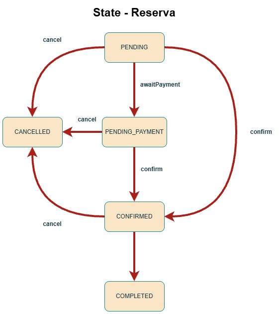

# Coworking

API REST para reservar espacios de coworking. La aplicación y PostgreSQL se levantan con Docker Compose desde la carpeta `coworking`.

## Requisitos para ejecutar

- Docker.
- Para correr las pruebas en tu máquina: Java 17.

### Levantar todos los contenedores

Posicionate en la carpeta `coworking` y ejecuta el comando:

```powershell
cd coworking
docker compose up -d
```

Con eso se crea la base de datos, se corren los scripts de `src/main/resources/db`, se construye y arranca la aplicación.

Cuando el contenedor `coworking-app` ya esté arriba, la API queda en `http://localhost:8080`. La documentación de la API está en `http://localhost:8080/swagger-ui.html`.

### Actualizar contenedor de la API

Cuando cambia el código de la aplicación, reconstruye y reiniciá ese servicio (PostgreSQL no se vuelve a crear).

```powershell
cd coworking
docker compose up -d --build --no-deps app
```

Si lo que querés es volver a levantar todos los servicios que ya estaban creados, usá:

```powershell
docker compose up -d
```

### Pruebas

Corré los comandos desde la carpeta `coworking`. La prueba de integración levanta PostgreSQL con Testcontainers, por lo cual Docker tiene que estar corriendo.

Solo la prueba unitaria de ocupación:

```powershell
.\mvnw.cmd "-Dtest=OccupancyServiceTest" test
```

Solo la prueba de integración del flujo de reservas:

```powershell
.\mvnw.cmd "-Dtest=ReservationFlowIntegrationTest" test
```

Todas las pruebas:

```powershell
.\mvnw.cmd test
```

## Requisitos técnicos

| Pieza                                | Por qué conviene                                                                          |
| ------------------------------------ | ----------------------------------------------------------------------------------------- |
| Spring Boot 3.5.16 y Java 17         | Framework y dependencias muy utiles.                                                      |
| Spring Data JPA                      | Guarda y consulta las reservas en PostgreSQL sin escribir el SQL de cada caso.            |
| `@Query` y `@EntityGraph`            | Evitan que un listado dispare una consulta extra por cada fila.                           |
| Spring Security con JWT              | Cada usuario entra con un token y solo hace lo que su rol permite.                        |
| Validación y `@ControllerAdvice`     | Rechazan datos malos y responden siempre con el mismo formato de error.                   |
| Actuator                             | Permite ver si la aplicación está funcionando, su información y sus métricas.             |
| Perfiles `dev` y `prod`              | Separan la configuración de desarrollo y la de producción.                                |
| `@ConfigurationProperties`           | Agrupan la configuración en un solo lugar, en vez de leerla suelta en el código.          |
| Caché del reporte                    | Repiten el mismo rango de fechas sin volver a calcular la ocupación.                      |
| `@Async` y el evento de confirmación | El aviso de la reserva sale después de responder, sin hacer esperar al usuario.           |
| `@Transactional`                     | Si dos reservas chocan, una se guarda y la otra se rechaza completa.                      |
| OpenAPI / Swagger                    | Muestran los endpoints y cómo probarlos sin leer el código.                               |
| Pruebas unitarias y de integración   | Comprueban el cálculo y el flujo real contra una base de datos.                           |
| Dockerfile y Docker Compose          | Levantan la API y PostgreSQL con un comando, igual en cualquier máquina.                  |
| Circuit breaker del pago             | Si el servicio de pago falla o se tarda, la reserva queda en espera en vez de romperse.   |
| Patrón State                         | Cada estado de la reserva sabe a cuáles puede pasar, sin un montón de condiciones juntas. |

## Patrón State

El patrón State encapsula las transiciones permitidas de una reserva en una clase por estado. La interfaz `ReservationState` define las acciones y, por defecto, rechaza las no válidas con `InvalidReservationException`. `ReservationService` delega la decisión al estado actual, así que agregar un estado nuevo no obliga a reescribir las reglas de los demás.

| Estado | Puede pasar a |
|---|---|
| `PENDING` | `CONFIRMED`, `PENDING_PAYMENT`, `CANCELLED` |
| `PENDING_PAYMENT` | `CONFIRMED`, `CANCELLED` |
| `CONFIRMED` | `COMPLETED`, `CANCELLED` |
| `CANCELLED` y `COMPLETED` | ninguna |

`ReservationState` define las acciones `confirm`, `cancel`, `complete` y `awaitPayment`. Esas acciones, por defecto, lanzan `InvalidReservationException`. Cada clase concreta solo sobrescribe las que sí son válidas para ese estado.



```java
private void changeStatus(Reservation reservation, ReservationStatus next) {
    ReservationState state = ReservationStates.of(reservation.getStatus());
    switch (next) {
        case CONFIRMED -> state.confirm(reservation);
        case CANCELLED -> state.cancel(reservation);
        case COMPLETED -> state.complete(reservation);
        case PENDING_PAYMENT -> state.awaitPayment(reservation);
        case PENDING -> throw new InvalidReservationException(
                "No se puede pasar de " + reservation.getStatus() + " a " + next
        );
    }
}
```

## Decisiones de diseño

El código está partido por responsabilidad:

| Paquete        | Qué decide                                                             |
| -------------- | ---------------------------------------------------------------------- |
| `controller`   | Recibe HTTP, valida el cuerpo y devuelve un DTO. No consulta la base.  |
| `service`      | Aplica las reglas: solape, pago, transición y caché.                   |
| `repository`   | Consultas JPA y el `@EntityGraph` que evita el N+1.                    |
| `dto`          | La entidad JPA no sale del servidor.                                   |
| `mapper`       | Traduce entidad a respuesta.                                           |
| `entity`       | Modelo persistido.                                                     |
| `entity.state` | Una clase por estado de la reserva.                                    |
| `exception`    | Errores de negocio y el `@ControllerAdvice` que los convierte en HTTP. |
| `config`       | JWT, caché, circuito y propiedades tipadas.                            |

**Aviso de la reserva.** El correo es un log que se dispara con un evento después del commit, en otro hilo. Ganas que la respuesta no espere al envío y que no se avise si la transacción se revierte. Pierdes entrega real, reintentos y un buzón de verdad.

**Pago inestable.** Si el servicio de pago falla o el circuito está abierto, la reserva pasa a `PENDING_PAYMENT` y la petición HTTP no falla.

**Solapamiento de reservas.** Antes de guardar se consulta si el horario choca y, si dos peticiones pasan a la vez, la base rechaza la segunda con una restricción de integridad. `create` corre en una sola transacción: `existsOverlap` y `saveAndFlush` van juntos, y si PostgreSQL rechaza el `INSERT` la transacción se revierte.

## Fuera de alcance

Con más tiempo se podría:

- Calcular la tarifa de forma dinámica según el tipo de espacio, el horario o la duración, y guardar el pago en una tabla aparte, como un recibo de la reserva.
- Enviar el correo de verdad.
- Sacar el pago a un servicio aparte.
- Pasar una reserva a `COMPLETED` sola cuando termina el horario.
